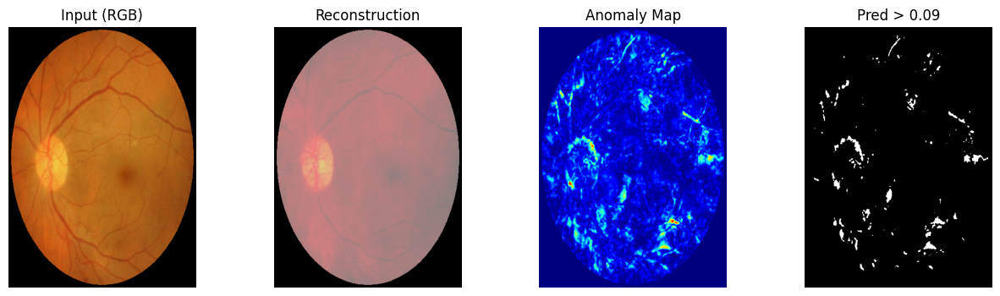
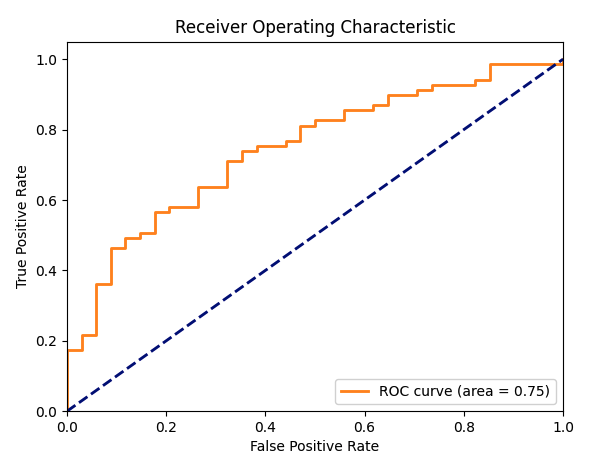
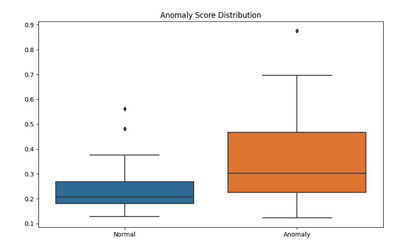

# THOR_DDPM_IDRiD

Adaptation of THOR_DDPM for anomaly detection in retinal fundus images with diffusion reconstruction.

## Upstream Credit
This project is adapted from the original **THOR_DDPM** repository by **Cosmin I. Bercea, Benedikt Wiestler, Daniel Rueckert, and Julia Schnabel**.

The core method and original implementation are from the upstream authors; this repository adds a retinal fundus configuration and evaluation workflow.

Upstream source: https://github.com/ci-ber/THOR_DDPM

## Example Output


The example images on this page were produced before the 2026-10-21 fix to the reconstruction range
(reconstructions were squeezed into [0.5, 1], hence the washed-out colours). Regenerate them by re-running the evaluation.

## Important Parts
- Main config: `projects/thor/configs/IDRiD/thor.yaml`
- Trainer: `projects/thor/DDPMTrainer.py`
- Evaluator: `projects/thor/DownstreamEvaluatorIDRiD.py`
- IDRiD loader: `data/loaders/IDRiD_loader.py`
- Key config fields: `experiment.task`, `experiment.weights`, `trainer.params.checkpoint_path`, `model.params.inference_type`, `model.params.noise_level_recon`, `model.params.t_harmonization`

## Setup
1. Create environment:
```bash
conda create -n thor python=3.8
conda activate thor
```
2. Install PyTorch for your system (CPU/CUDA).
3. Install dependencies:
```bash
pip install -r pip_requirements.txt
```
4. Optional: install an `xformers` build that matches your installed PyTorch for memory-efficient attention.
   The U-Net falls back to standard attention without it.

Logging is local in this branch (`weights/`, `results/`). `wandb login` is not required.

## Data Preparation
The dataset is not included. `IDRiD` in the repository, folder and config names is historical; any retinal fundus images in this layout work.

Use `projects/thor/configs/IDRiD/thor.yaml` and prepare these CSV splits:
- `data/IDRiD_normalize/splits/train_normal.csv`
- `data/IDRiD_normalize/splits/train_idrid_only.csv`
- `data/IDRiD_normalize/splits/val_normal.csv`
- `data/IDRiD_normalize/splits/test_normal.csv`
- `data/IDRiD_normalize/splits/test_DR.csv`

CSV format:
```csv
filename
/path/to/image_001.png
/path/to/image_002.png
```

Label rule in evaluator:
- path containing `/normal/` or `/good/` -> `label=0`
- otherwise -> `label=1`

The evaluator logs how many images got each label; check it, because a split whose paths lack those folders is labelled all anomalous.
`train_normal.csv` and `train_idrid_only.csv` must contain healthy images only, and no image may appear in both a train and a test split.

## Run
```bash
python core/Main.py --config_path projects/thor/configs/IDRiD/thor.yaml
```

For training:
- set `experiment.task: train`
- set `experiment.weights: null` to train from scratch, or a checkpoint path to fine-tune from it
- set `experiment.resume: true` only to continue an interrupted run (restores the optimizer and starts after the saved epoch)

For evaluation:
- set `experiment.task: test`
- set `experiment.weights: <path_to_best_model.pt>`

## Anomaly Score
- The THOR reconstruction is compared with the input inside a field-of-view mask; the score is the masked mean squared error.
  THOR's anomaly maps are used for harmonization and visualization, not for the score.
- The decision threshold is the 95th percentile of validation normals (`val_normal.csv`, `val_data_loader` in the config).
  Without validation data it falls back to the test normals, and `global_metrics.txt` warns that `Pred_Label` is then optimistic.

## Outputs
Checkpoint folder:
- `weights/thor/idrid/<timestamp>/`
- includes `latest_model.pt`, `best_model.pt`, `training.log`, `Val_epoch_*.png`
- validation runs every `val_interval` epochs and after the last epoch; `best_model.pt` has the lowest validation loss

Evaluation folder:
- `results/<timestamp>/`
- `per_image_scores.csv` (always saved; `Pred_Label` and `Correct` appear only when threshold is available)
- `global_metrics.txt` (always saved; AUROC/AUPRC only when both classes exist; states whether the threshold came from validation or test normals)
- `roc_curve.png` (only when both classes exist)
- `score_overlap.png` (only when overlap is computable)
- `visualizations/*.png`

## Metric Examples
ROC curve example:



Anomaly score distribution (custom analysis example):



## Notes
- Data, checkpoints, and results are git-ignored.
